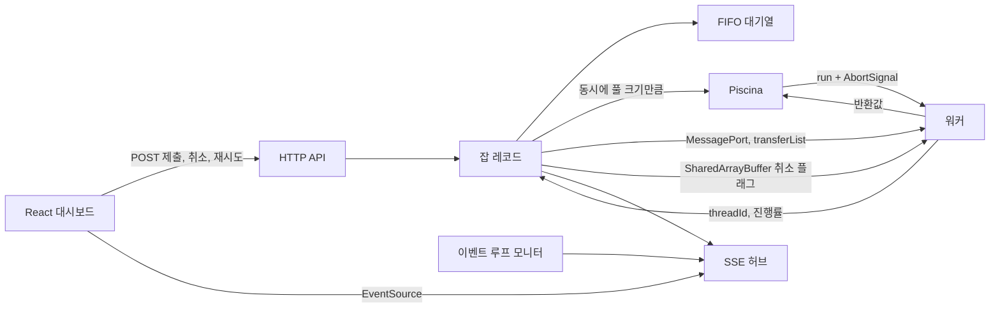
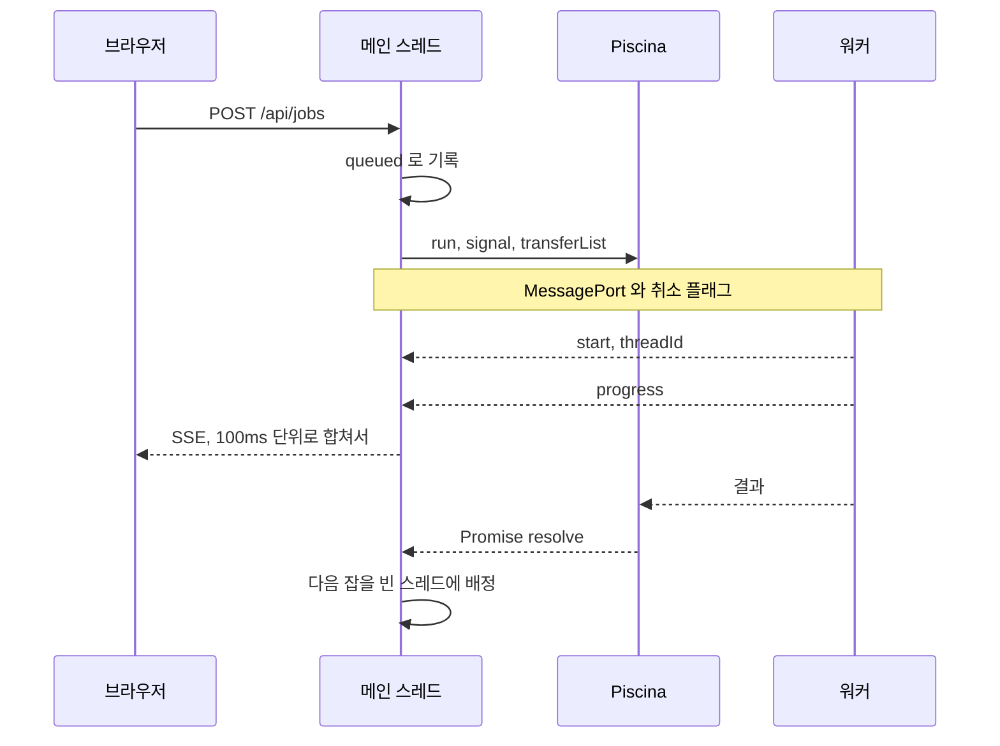
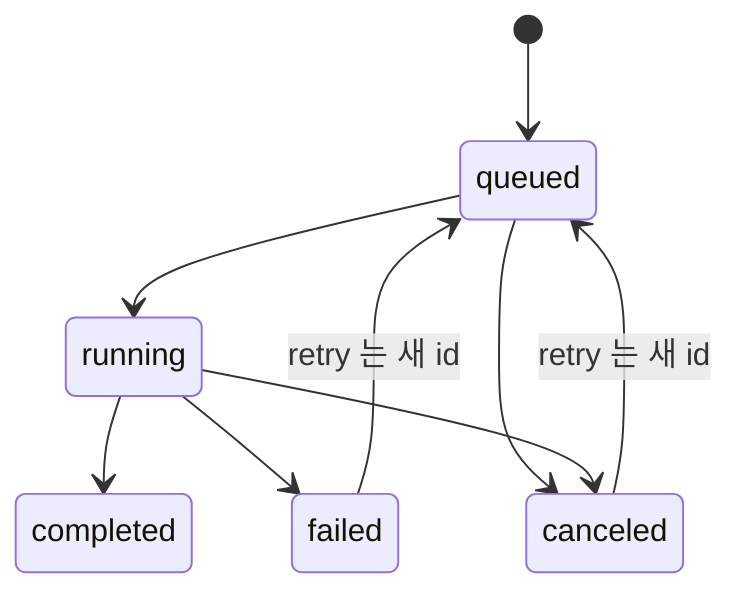

# Yard

CPU를 많이 쓰는 작업을 고정 크기의 [Piscina](https://github.com/piscinajs/piscina) 풀에 넘기고, 진행 상황을 대시보드에서 실시간으로 보는 잡 러너입니다. 계산은 워커 스레드 안에서만 돌고, 메인 스레드의 이벤트 루프는 비워 둡니다.


위 화면은 코어 4개인 머신에서 풀 크기 3으로 소수 세기 50개를 넣은 직후입니다. 큐 47, 실행 3, 완료 0이고 레일 이름은 워커의 `threadId`인 1, 2, 3입니다. 메인 스레드 하트비트 지연은 1.0ms입니다.

## 실행

Node.js 22 이상, pnpm 10이 필요합니다.

```bash
pnpm install
pnpm dev
```

- 대시보드: http://127.0.0.1:5173
- API: http://127.0.0.1:8787

`Run 50 jobs`가 현재 프리셋으로 잡을 한 번에 넣습니다. `Run 1`은 하나만 넣습니다. 실행 중인 잡은 Cancel, 실패하거나 취소된 잡은 Retry입니다.

```bash
pnpm test
pnpm lint
pnpm typecheck
pnpm build
pnpm --filter @yard/server start   # 빌드 결과. 대시보드 정적 파일은 NODE_ENV=production 일 때 같이 제공합니다.
```

Docker:

```bash
docker compose up --build
```

브라우저에서 http://localhost:8787 을 엽니다. 이미지 안에서는 API와 빌드된 대시보드가 같은 오리진입니다.

## 아키텍처

잡 레코드, 대기열, 레인은 메인 스레드에 있습니다. CPU 작업만 Piscina 워커로 갑니다. 사용한 버전은 npm `latest`로 확인한 **5.3.2**이고, `run(task, { signal, transferList })`와 `minThreads` / `maxThreads` / `idleTimeout`은 [그 버전의 README](https://github.com/piscinajs/piscina/blob/v5.3.2/README.md)를 기준으로 했습니다.







재시도는 기존 잡을 되돌리지 않습니다. 같은 타입과 파라미터로 새 잡을 만들고 `retryOf`에 이전 id를 남깁니다.

## 워커 풀

풀 크기의 기본값은 `os.availableParallelism() - 1`이고, 최소 1입니다. `POOL_SIZE`로 바꿉니다. Piscina에는 `minThreads`와 `maxThreads`를 그 값으로 같이 주고, `idleTimeout`은 `Infinity`, `concurrentTasksPerWorker`는 1입니다. 기본 `idleTimeout` 0은 일이 끊기면 스레드를 바로 죽여서 `threadId`가 바뀌고 레일이 흔들립니다. 스레드 수를 고정해 두면 레일 이름이 프로세스 동안 유지됩니다.

대기열은 우리 쪽 FIFO입니다. Piscina 안에 동시에 들어가는 태스크는 풀 크기를 넘지 않습니다. 대기 중인 잡은 `run()` 전에 취소하므로 `startedAt`이 비고, 워커를 죽이지 않습니다.

메인 스레드는 잡을 실행하지 않습니다. 워커가 일을 하는 동안 100ms 하트비트의 지연은 0ms 근처에 남습니다. 대시보드의 Main thread 게이지가 그 값입니다. `perf_hooks.monitorEventLoopDelay`의 p99도 같이 보냅니다.

진행률은 태스크마다 만든 `MessageChannel`로 받습니다. 워커 쪽 포트는 `transferList`로 넘깁니다. 잡은 시작하자마자 `{ type: 'start', threadId }`를 보내고, 그 다음 퍼센트와 메시지를 보냅니다. 대시보드 레일 id는 그 `threadId`의 문자열입니다. 결과 Promise와 이 포트는 서로 다른 채널이라 순서가 보장되지 않습니다. 완료를 기록하기 전에 `receiveMessageOnPort`로 포트에 남아 있는 진행률을 먼저 적용합니다. 숫자는 커질 때만 반영하고, 늦게 도착한 더 작은 값은 버립니다.

취소는 두 단계입니다. 모든 `run()`에 `AbortSignal`을 넘깁니다. Piscina 5.3.2는 실행 중인 태스크를 abort하면 그 워커 스레드를 멈춥니다. CPU를 꽉 잡는 루프는 이벤트 루프로 돌아오지 않아서 abort 이벤트를 중간에서 보지 못합니다. 그래서 플래그는 예전과 같이 `SharedArrayBuffer` 위 `Int32Array`이고, 핫 루프는 `Atomics.load`로 봅니다. 플래그를 보면 태스크가 정상 반환하고 같은 `threadId`가 다음 잡을 받습니다. 레일이 끊기지 않습니다. `750ms` 안에 멈추지 않으면 `AbortController.abort()`로 Piscina가 워커를 교체합니다.

타임아웃은 큐에서 기다린 시간이 아니라, `run()`을 호출한 뒤의 실행 시간입니다. 뒤에 선 잡이 자기 차례가 오기 전에 실패하지 않게 하려는 선택입니다. 시간을 넘기면 잡을 `timed out`으로 닫고 signal을 abort합니다. 플래그를 무시하는 루프도 여기서 끊기고, 풀은 다음 잡을 받습니다. 교체된 스레드는 새 `threadId`를 가집니다.

워커가 `process.exit`로 죽거나 잡이 예외를 던지면 그 잡은 실패가 됩니다. Piscina는 죽은 스레드를 `minThreads`까지 다시 채웁니다. 다른 레인은 이어서 일합니다. 부팅이 반복해서 실패하면 Piscina가 그 풀의 재시작을 멈춥니다.

## 잡

네 가지 모두 청크마다 진행률을 보내고, 청크 경계에서 취소를 확인합니다. 결과로 큰 배열을 다시 보내지 않습니다. 정렬 결과는 체크섬과 양 끝값만, 블러는 sha256 다이제스트만 돌아옵니다.

| 타입 | 하는 일 | yard 프리셋 |
| --- | --- | --- |
| `prime` | 분할 에라토스테네스 체로 N까지의 소수 개수 | limit 2.8억 |
| `sort` | 시드된 난수로 배열을 채우고 바텀업 머지소트 | 길이 500만 |
| `blur` | 행렬 박스 블러 후 sha256을 여러 라운드 | 512², 6패스, 90만 라운드 |
| `montecarlo` | 시드된 난수로 원 안의 점을 세어 π 추정 | 샘플 7천만 |

`short` / `yard` / `long`은 대시보드의 프리셋입니다. yard는 이 머신에서 잡 하나당 대략 1초입니다. 파라미터 범위는 `packages/shared`의 `PARAM_LIMITS`에 있습니다.

## 실시간 채널

브라우저로 나가는 데이터는 잡 상태, 진행률, 풀 스냅샷뿐입니다. 명령은 전부 `POST`입니다. 그래서 WebSocket 대신 **SSE**를 씁니다.

- 방향이 서버에서 클라이언트로 고정되어 있어서 프로토콜을 따로 버전 관리할 필요가 없습니다.
- `EventSource`가 끊기면 스스로 다시 붙고, 접속 직후 `snapshot` 이벤트로 현재 잡과 풀을 받습니다.
- Vite 개발 프록시와 Docker의 단일 포트 모두 일반 HTTP로 통과합니다.

진행률은 잡 id마다 마지막 값만 남기고 **100ms마다 한 번** 보냅니다. 이벤트가 계속 와도 타이머를 뒤로 밀지 않습니다. 조용해질 때까지 기다리는 디바운스라면, 바쁜 잡은 영원히 갱신이 늦어집니다. `queued`, 실행 시작, 완료, 실패, 취소는 버퍼에 쌓인 진행률과 함께 바로 보냅니다.

## 손수 만든 풀에서 바뀐 점

직전 구현은 [`b3805ce`의 `worker-pool.ts`](https://github.com/santarosalia/worker-job-dashboard/blob/b3805ce969c30b4c7d58051ec3cd38a82ba42e65/packages/server/src/pool/worker-pool.ts)입니다. 슬롯마다 `new Worker`를 하고 `postMessage`로 `start`를 보내던 루프, ready 핸드셰이크, 직접 `terminate` 후 같은 이름(`w1`, `w2`)으로 다시 띄우던 코드는 뺐습니다. 스레드를 만들고, 살려 두고, 죽으면 채우는 일은 Piscina가 합니다.

잡의 공개 표면은 그대로입니다. `submit`, `cancel`, `retry`, `get`, `list`, `stats`, `snapshot`, `subscribe`, `whenReady`, `destroy`를 HTTP와 SSE, 대시보드가 예전과 같이 부릅니다. `jobs/*.ts`는 `JobContext`만 보고, 풀을 모릅니다.

| | 손수 만든 풀 | 지금 |
| --- | --- | --- |
| 스레드 | 슬롯 `w1`… 고정 | Piscina `minThreads = maxThreads`, `idleTimeout: Infinity` |
| 레일 이름 | 슬롯 id | 워커 `threadId` |
| 일 넘기기 | `postMessage` `start` | `piscina.run` |
| 진행률 | 같은 포트의 `progress` | 태스크별 `MessagePort` (`transferList`) |
| 취소 | SAB 플래그, 유예 후 `terminate` | SAB 플래그, 유예 후 `AbortSignal` |
| 타임아웃 | 타이머 후 워커 교체 | 타이머 후 abort. 잡은 `timed out` |
| 크래시 | 잡을 실패로 닫고 슬롯을 다시 띄움 | 잡을 실패로 닫고 Piscina가 스레드를 채움 |
| 대기열 | 우리 FIFO | 우리 FIFO. Piscina 큐는 넘기지 않은 잡을 두지 않음 |

workerpool에서 가져왔던 선택도 남아 있습니다. 기본 크기는 CPU 수 − 1이고, 워커 하나는 잡을 하나만 하며, 멈춘 워커는 고쳐서 쓰지 않고 교체합니다. Piscina의 동적 min/max, 커스텀 큐, 태스크 히스토그램은 쓰지 않습니다. 대시보드가 그리는 것은 여전히 잡 레코드입니다.

### 처리량과 이벤트 루프 지연

같은 머신에서 손수 만든 풀(`b3805ce`)과 이 풀을 번갈아 재었습니다. Node.js 22.23.4, 논리 CPU 4개, 풀 크기 3. 잡은 양쪽 다 분할 에라토스테네스 체(`prime`)입니다. 라운드마다 풀을 새로 만들고, 스레드가 뜬 뒤 워밍업 배치를 한 번 돌려 워커 모듈을 읽힌 다음 시간을 재었습니다. 순서는 라운드마다 뒤집었습니다. 숫자는 3회 중앙값입니다.

| | 손수 만든 풀 | Piscina |
| --- | --- | --- |
| 48개, limit 400만 | 243ms, 약 198개/초 | 243ms, 약 198개/초 |
| 18개, limit 4천만 | 796ms | 790ms |
| 위 배치 동안 100ms 하트비트 최대 지연 | 1ms | 1ms. 한 라운드는 5ms |

세 라운드의 짧은 배치는 235–250ms 안에 들어왔습니다. 워밍업 뒤의 처리량은 구분되지 않습니다.

워밍업을 빼면 다릅니다. 새 Piscina 풀의 첫 48개는 451–474ms였고, 손수 만든 풀은 248–281ms였습니다. Piscina는 처음 띄운 스레드를 태스크 모듈 로드가 끝나기 전에 준비로 표시해서, 그 import가 첫 배치 시간에 들어갑니다. 손수 만든 풀의 ready는 스크립트를 다 읽은 뒤입니다.

같은 limit 4천만 체를 메인 스레드에서 두 번 돌리면 100ms 하트비트가 163ms 밀렸습니다. 워커로 넘긴 배치에서는 두 풀 다 1ms 근처입니다. `monitorEventLoopDelay({ resolution: 20 })`의 p99는 두 풀과 메인 스레드 측정 모두 20ms 안팎이었습니다. 이 Node 버전에서는 그 히스토그램이 샘플 해상도에 붙어서, 163ms 정지도 가르지 못했습니다. 대시보드 게이지와 같은 하트비트를 기준으로 비교했습니다.

## API

| 메서드 | 경로 | |
| --- | --- | --- |
| `GET` | `/api/health` | 풀 크기 |
| `GET` | `/api/pool` | 워커, 레일, 처리량, 이벤트 루프 지연 |
| `GET` | `/api/jobs?limit=` | 최신 잡 |
| `GET` | `/api/jobs/:id` | 잡 하나 |
| `POST` | `/api/jobs` | `{ type, params?, timeoutMs? }` |
| `POST` | `/api/jobs/bulk` | 위에 `count` (1–200) |
| `POST` | `/api/jobs/:id/cancel` | 대기 중이면 바로 취소, 실행 중이면 플래그 후 유예되면 AbortSignal |
| `POST` | `/api/jobs/:id/retry` | 실패 또는 취소된 잡만 |
| `GET` | `/api/events` | SSE. `snapshot`, `batch`, `ping` |

`params`를 생략하면 그 타입의 yard 프리셋이 들어갑니다.

```bash
curl -s -X POST localhost:8787/api/jobs \
  -H 'content-type: application/json' \
  -d '{"type":"montecarlo","params":{"samples":2000000,"seed":1}}'
```

## 환경 변수

| 변수 | 기본 | |
| --- | --- | --- |
| `PORT` | `8787` | |
| `POOL_SIZE` | CPU − 1 | 1–64 |
| `JOB_TIMEOUT_MS` | `30000` | 실행 시간 제한. 요청에서 덮어쓸 수 있습니다. |
| `WEB_DIST` | 프로덕션에서 빌드된 대시보드 | |
| `NODE_ENV` | | `production`이면 정적 파일을 찾습니다. |

## 테스트

Vitest입니다. 풀 테스트는 통제 가능한 워커를 실제로 띄웁니다.

- 동시에 도는 잡은 풀 크기를 넘지 않고, 시작 순서는 넣은 순서입니다.
- 대기 중인 잡을 취소하면 시작하지 않고, 그 뒤의 잡은 이어서 돕니다.
- 실행 중 취소는 100% 전에 멈추고, 같은 `threadId`가 다음 잡을 받습니다.
- 타임아웃은 잡을 실패로 닫고, 다음 잡은 새 스레드에서 끝납니다.
- `process.exit`로 죽은 워커는 잡 실패 후 Piscina가 다시 띄웁니다.
- 진행률 15가 40 뒤에 오면 15는 버려지고, 관측된 값은 줄지 않습니다.
- 재시도는 새 id와 `attempt: 2`를 만듭니다.
- 이벤트 허브는 같은 잡의 진행률을 한 번의 flush로 합치고, 종료 상태는 바로 보냅니다.
- API 스모크 테스트는 포트를 열고 제출, 목록, 취소, 타임아웃, 재시도, SSE `snapshot`을 확인합니다.

잡 함수 단위 테스트는 소수 개수(π(1000) = 168), 정렬 결과, 블러 다이제스트, 시드된 π 추정이 결정적인지, 그리고 중간에 취소되면 던지는지를 봅니다.

## 레이아웃

```
packages/shared   잡 타입, 프리셋, 와이어 형식
packages/server   풀, 잡, Hono API, SSE
packages/web      Vite + React 대시보드
```

서버 빌드는 esbuild로 `dist/index.js`와 `dist/worker.js`를 따로 만듭니다. 워커는 메인 번들에 넣지 않습니다. Piscina는 번들에 넣지 않고 `dist/node_modules/piscina`로 복사합니다. 라이브러리가 자기 `worker.js`를 패키지 디렉터리에서 찾기 때문이고, 이미지에는 `dist/`만 들어갑니다. 개발 중에는 `tsx`가 워커의 TypeScript를 그대로 띄웁니다.

CI(`.github/workflows/ci.yml`)는 lint, typecheck, test, build를 돌립니다.
