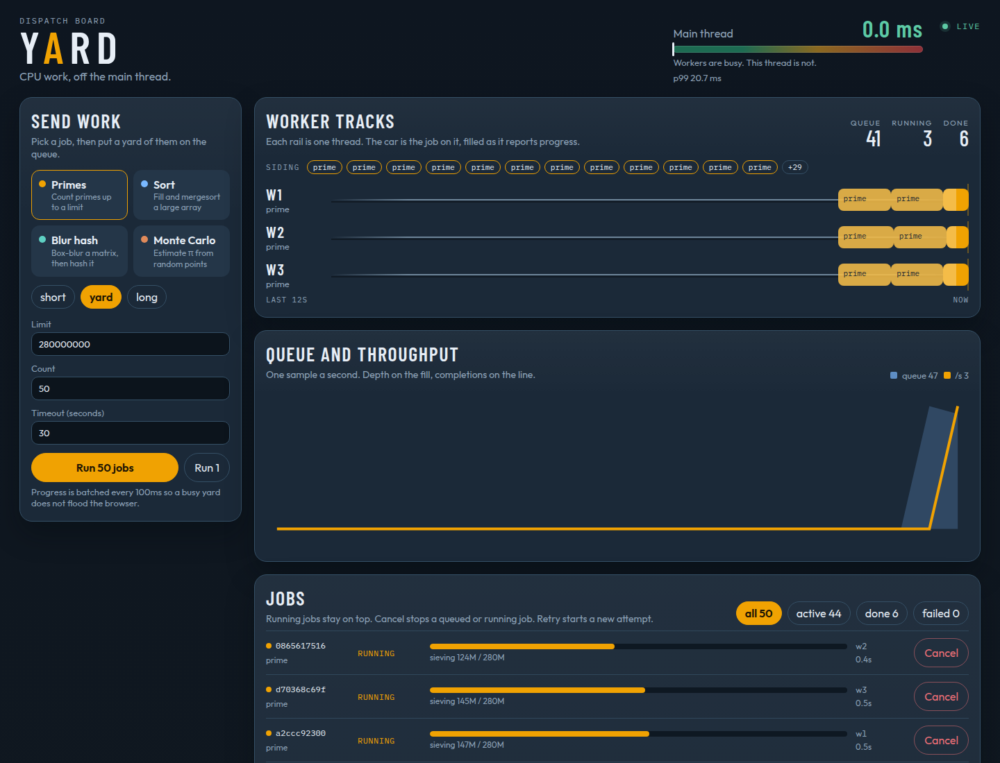
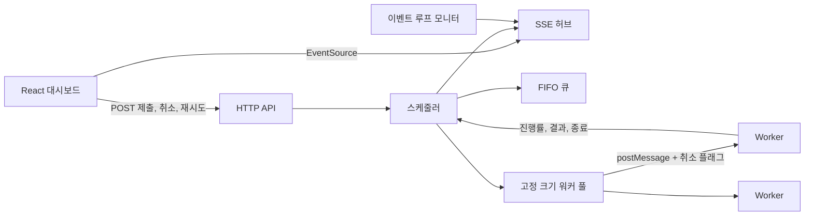
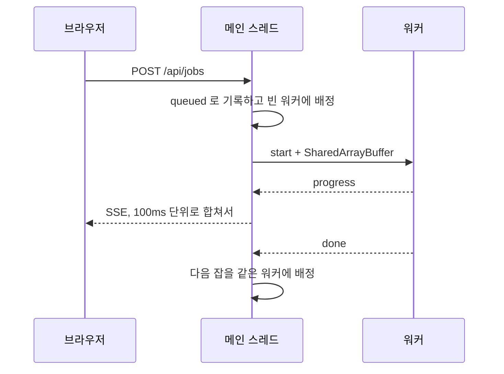
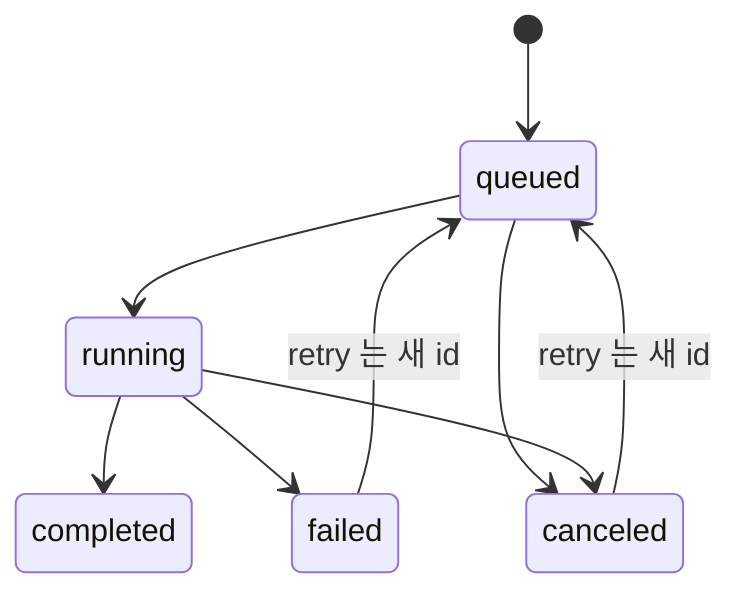

# Yard

CPU를 많이 쓰는 작업을 고정 크기의 워커 스레드 풀에 넘기고, 진행 상황을 대시보드에서 실시간으로 보는 잡 러너입니다. 계산은 워커 스레드 안에서만 돌고, 메인 스레드의 이벤트 루프는 비워 둡니다.



위 화면은 코어 4개인 머신에서 풀 크기 3으로 소수 세기 50개를 넣은 직후입니다. 큐 41, 실행 3, 완료 6이고 메인 스레드 하트비트 지연은 0.0ms입니다.

## 실행

Node.js 22 이상, pnpm 10이 필요합니다.

```bash
pnpm install
pnpm dev
```

- 대시보드: http://127.0.0.1:5173
- API: http://127.0.0.1:8787

`Run 50 jobs`가 현재 프리셋으로 잡을 한 번에 넣습니다. `Run 1`은 하나만 넣습니다. 실행 중인 잡은 Cancel, 실패하거나 취소된 잡은 Retry입니다.

```bash
pnpm test
pnpm lint
pnpm typecheck
pnpm build
pnpm --filter @yard/server start   # 빌드 결과. 대시보드 정적 파일은 NODE_ENV=production 일 때 같이 제공합니다.
```

Docker:

```bash
docker compose up --build
```

브라우저에서 http://localhost:8787 을 엽니다. 이미지 안에서는 API와 빌드된 대시보드가 같은 오리진입니다.

## 아키텍처







재시도는 기존 잡을 되돌리지 않습니다. 같은 타입과 파라미터로 새 잡을 만들고 `retryOf`에 이전 id를 남깁니다.

## 워커 풀

풀 크기의 기본값은 `os.availableParallelism() - 1`이고, 최소 1입니다. `POOL_SIZE`로 바꿉니다. 워커 하나는 잡을 하나만 들고, 대기열은 FIFO입니다.

메인 스레드는 잡을 실행하지 않습니다. 워커에 `postMessage`로 일을 넘기고, 워커가 보내는 진행률과 결과만 기록합니다. 그래서 워커가 소수 세기를 하는 동안에도 100ms 하트비트의 지연이 0ms 근처에 남습니다. 대시보드의 Main thread 게이지가 그 값입니다. `perf_hooks.monitorEventLoopDelay`의 p99도 같이 보냅니다.

취소는 `SharedArrayBuffer` 위의 `Int32Array` 플래그입니다. 워커의 핫 루프는 `Atomics.load`로 이 플래그를 봅니다. 메시지 이벤트를 기다리지 않아도 되므로, CPU를 꽉 잡는 루프 중간에도 취소가 먹습니다. 워커가 스스로 멈추면 그 스레드는 다음 잡에 재사용합니다. `750ms` 안에 멈추지 않으면 `worker.terminate()`로 죽이고 같은 레일(`w1`, `w2`, …)에 새 워커를 띄웁니다.

타임아웃은 큐에서 기다린 시간이 아니라, 워커에 올라간 뒤의 실행 시간입니다. 뒤에 선 잡이 자기 차례가 오기 전에 실패하지 않게 하려는 선택입니다. 시간을 넘기면 잡을 실패로 닫고 워커를 교체합니다. 멈춰 있는 루프는 취소 플래그를 무시할 수 있어서, 타임아웃은 협조에 기대지 않습니다.

워커가 죽거나 예외로 내려가면 그 잡은 실패가 되고, 슬롯은 새 워커로 채워집니다. 부팅에 반복해서 실패하면 그 슬롯은 재시작을 멈춥니다.

진행률은 숫자만 커질 때 반영합니다. 늦게 도착한 더 작은 값은 버립니다.

## 잡

네 가지 모두 청크마다 진행률을 보내고, 청크 경계에서 취소를 확인합니다. 결과로 큰 배열을 다시 보내지 않습니다. 정렬 결과는 체크섬과 양 끝값만, 블러는 sha256 다이제스트만 돌아옵니다.

| 타입 | 하는 일 | yard 프리셋 |
| --- | --- | --- |
| `prime` | 분할 에라토스테네스 체로 N까지의 소수 개수 | limit 2.8억 |
| `sort` | 시드된 난수로 배열을 채우고 바텀업 머지소트 | 길이 500만 |
| `blur` | 행렬 박스 블러 후 sha256을 여러 라운드 | 512², 6패스, 90만 라운드 |
| `montecarlo` | 시드된 난수로 원 안의 점을 세어 π 추정 | 샘플 7천만 |

`short` / `yard` / `long`은 대시보드의 프리셋입니다. yard는 이 머신에서 잡 하나당 대략 1초입니다. 파라미터 범위는 `packages/shared`의 `PARAM_LIMITS`에 있습니다.

## 실시간 채널

브라우저로 나가는 데이터는 잡 상태, 진행률, 풀 스냅샷뿐입니다. 명령은 전부 `POST`입니다. 그래서 WebSocket 대신 **SSE**를 씁니다.

- 방향이 서버에서 클라이언트로 고정되어 있어서 프로토콜을 따로 버전 관리할 필요가 없습니다.
- `EventSource`가 끊기면 스스로 다시 붙고, 접속 직후 `snapshot` 이벤트로 현재 잡과 풀을 받습니다.
- Vite 개발 프록시와 Docker의 단일 포트 모두 일반 HTTP로 통과합니다.

진행률은 잡 id마다 마지막 값만 남기고 **100ms마다 한 번** 보냅니다. 이벤트가 계속 와도 타이머를 뒤로 밀지 않습니다. 조용해질 때까지 기다리는 디바운스라면, 바쁜 잡은 영원히 갱신이 늦어집니다. `queued`, 실행 시작, 완료, 실패, 취소는 버퍼에 쌓인 진행률과 함께 바로 보냅니다.

## Piscina, workerpool, 그리고 이 풀

풀은 라이브러리를 감싼 것이 아니라 `node:worker_threads`로 직접 만들었습니다. 두 프로젝트에서 가져온 패턴만 적습니다.

| | [Piscina](https://github.com/piscinajs/piscina) | [workerpool](https://github.com/josdejong/workerpool) | Yard |
| --- | --- | --- | --- |
| 스레드 수 | min/max. 기본은 `availableParallelism()` | min/max. 기본은 CPU 수 − 1 | 고정. 기본은 CPU 수 − 1 |
| 큐 | FIFO, 교체 가능 | FIFO | FIFO |
| 취소 | `AbortSignal`이 워커를 바로 죽임 | `cancel()`이 워커를 바로 죽임 | SAB 플래그로 협조 취소, 유예 후 종료 |
| 타임아웃 | 풀의 기능이 아님 | 실행 시작 후 타이머, 워커 종료 | 실행 시작 후 타이머, 워커 교체 |
| 진행률 | 없음 | 없음 | 퍼센트와 메시지, 100ms로 합침 |
| 잡의 수명 | 호출당 Promise | 호출당 Promise | 조회, 목록, 재시도가 되는 레코드 |
| 크래시 | 워커를 다시 띄움 | 워커를 다시 띄움 | 잡을 실패로 닫고 같은 레일에 다시 띄움 |

Piscina는 `SharedArrayBuffer`와 `Atomics`를 태스크 완료를 기다리는 동기화에 씁니다. 여기서는 그 채널을 취소 플래그에 씁니다. 워커가 이벤트 루프로 돌아오지 않아도 메인 스레드가 플래그를 세울 수 있습니다.

workerpool의 기본 크기(CPU − 1), 워커당 작업 하나, 멈춘 워커는 살리지 않고 교체한다는 쪽을 따릅니다. Piscina의 동적 min/max, 커스텀 큐, 히스토그램, transferable 최적화와 workerpool의 브라우저 워커, 프록시 API는 넣지 않았습니다. 이 풀의 중심은 대시보드가 그릴 수 있는 잡 레코드입니다.

## API

| 메서드 | 경로 | |
| --- | --- | --- |
| `GET` | `/api/health` | 풀 크기 |
| `GET` | `/api/pool` | 워커, 레일, 처리량, 이벤트 루프 지연 |
| `GET` | `/api/jobs?limit=` | 최신 잡 |
| `GET` | `/api/jobs/:id` | 잡 하나 |
| `POST` | `/api/jobs` | `{ type, params?, timeoutMs? }` |
| `POST` | `/api/jobs/bulk` | 위에 `count` (1–200) |
| `POST` | `/api/jobs/:id/cancel` | 대기 중이면 바로 취소, 실행 중이면 플래그 |
| `POST` | `/api/jobs/:id/retry` | 실패 또는 취소된 잡만 |
| `GET` | `/api/events` | SSE. `snapshot`, `batch`, `ping` |

`params`를 생략하면 그 타입의 yard 프리셋이 들어갑니다.

```bash
curl -s -X POST localhost:8787/api/jobs \
  -H 'content-type: application/json' \
  -d '{"type":"montecarlo","params":{"samples":2000000,"seed":1}}'
```

## 환경 변수

| 변수 | 기본 | |
| --- | --- | --- |
| `PORT` | `8787` | |
| `POOL_SIZE` | CPU − 1 | 1–64 |
| `JOB_TIMEOUT_MS` | `30000` | 실행 시간 제한. 요청에서 덮어쓸 수 있습니다. |
| `WEB_DIST` | 프로덕션에서 빌드된 대시보드 | |
| `NODE_ENV` | | `production`이면 정적 파일을 찾습니다. |

## 테스트

Vitest입니다. 풀 테스트는 통제 가능한 워커를 실제로 띄웁니다.

- 동시에 도는 잡은 풀 크기를 넘지 않고, 시작 순서는 넣은 순서입니다.
- 대기 중인 잡을 취소하면 시작하지 않고, 그 뒤의 잡은 이어서 돕니다.
- 실행 중 취소는 100% 전에 멈추고, 같은 레일이 다음 잡을 받습니다.
- 타임아웃은 잡을 실패로 닫고, 다음 잡은 새 워커에서 끝납니다.
- `process.exit`로 죽은 워커는 잡 실패 후 다시 뜹니다.
- 진행률 15가 40 뒤에 오면 15는 버려지고, 관측된 값은 줄지 않습니다.
- 재시도는 새 id와 `attempt: 2`를 만듭니다.
- 이벤트 허브는 같은 잡의 진행률을 한 번의 flush로 합치고, 종료 상태는 바로 보냅니다.
- API 스모크 테스트는 포트를 열고 제출, 목록, 취소, 타임아웃, 재시도, SSE `snapshot`을 확인합니다.

잡 함수 단위 테스트는 소수 개수(π(1000) = 168), 정렬 결과, 블러 다이제스트, 시드된 π 추정이 결정적인지, 그리고 중간에 취소되면 던지는지를 봅니다.

## 레이아웃

```
packages/shared   잡 타입, 프리셋, 와이어 형식
packages/server   풀, 잡, Hono API, SSE
packages/web      Vite + React 대시보드
```

서버 빌드는 esbuild로 `dist/index.js`와 `dist/worker.js`를 따로 만듭니다. 워커는 메인 번들에 넣지 않습니다. 개발 중에는 `tsx`가 워커의 TypeScript를 그대로 띄웁니다.

CI(`.github/workflows/ci.yml`)는 lint, typecheck, test, build를 돌립니다.
